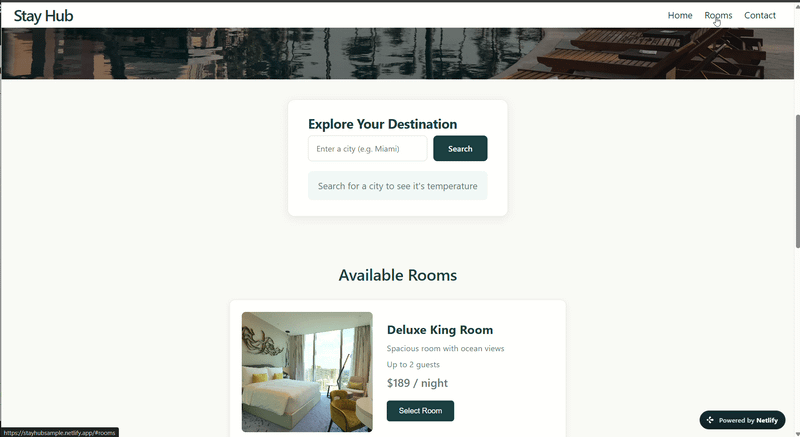

# Personal Project *Stay Hub*

Created by: **Gabriel Villanueva**

# Link to Live Project

[Click here](https://stayhubsample.netlify.app/)

**Stay Hub** is a web application of a demo hotel company, users are greeted with a message on a hero section, and a button directs them to explore different hotel room options. There is a small card that allows users to view the current temperature at their destination, and then Available rooms are listed in a vertical display of cards. Users can pick between 3 different options, and finally complete their reservation by selecting check in and check out dates and clicking the Reserve Room button.

## Tech Stack

- **Frontend:** React, JavaScript, HTML, CSS, Vite
- **Backend:** Netlify Serverless Functions
- **Database:** Supabase (PostgreSQL)
- **APIs:** Open-Meteo Weather API
- **Deployment:** Netlify
- **Version Control:** Git and GitHub

## Features

The following functionality is completed:

* [x] A navigation bar where users can move to the home, rooms or contact part of the webpage.
* [x] A hero section with a welcome message and a button directing the user to the room section.
* [x] A card displaying the current weather of the city that the user enters, this card is operating with an API.
* [x] A vertical card display showing different room options, their cost and a small description of the room.
* [x] A Booking summary card, where the user picks the dates they will like to check in and check out from, and a summary of their selected choices and the total cost.

## Video Walkthrough

Here's a walkthrough of implemented features:

GIF created with **ezgif.com**

## Notes

The most challenging aspect of creating this application was ensuring the weather API worked correctly, and that date selections were checked to make sure they made sense and realsitic.
